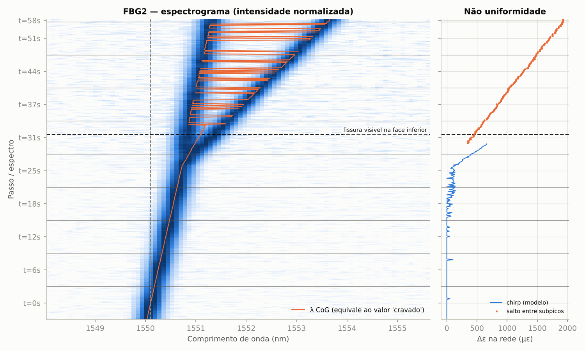
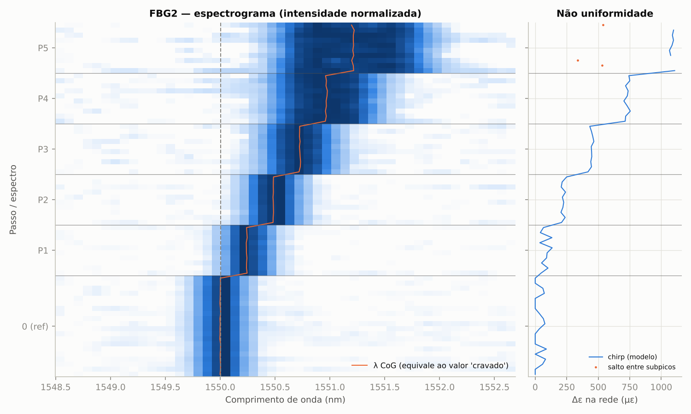
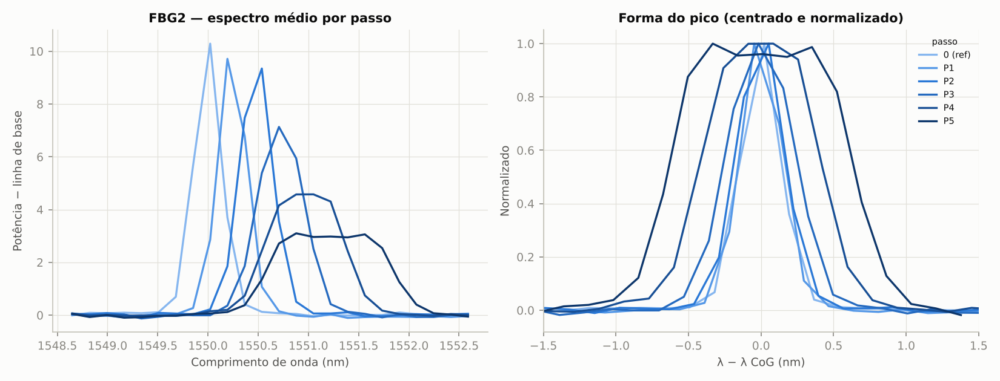

# fbg_lab — espectro bruto e chirp das FBGs no ILLumiSense

O ILLumiSense só entrega, por TCP e no log, o **comprimento de onda de pico**
(centro de gravidade) de cada FBG. Esta ferramenta busca o **espectro
completo** do detector (512 pixels, ~0,17 nm/pixel) para enxergar a **forma**
do pico: alargamento, assimetria e divisão — os sinais de deformação não
uniforme ao longo da rede (chirp).

Como funciona e de onde vieram as informações: [`../docs/engenharia_reversa.md`](../docs/engenharia_reversa.md).

## Instalação (PC do laboratório, Windows)

1. Python 3.10 ou mais novo (64 bits serve para o modo web; o modo DLL exige 32 bits).
2. Nesta pasta: `pip install -r requirements.txt` (ou dê dois cliques em `instalar.bat`).
3. Com o ILLumiSense **aberto e medindo**, teste a conexão:

```bat
python -m fbglab sondar
```

Deve aparecer `[OK] http://localhost:8002/ILLWS/GetHWInformation/` e os canais
que respondem. Também dá para testar no navegador:
`http://localhost:8002/ILLWS/GetSpectrum/1`.

## Comandos

| Comando | Para quê |
|---|---|
| `python -m fbglab ao-vivo` | janela com o espectro atual, a referência e a cascata (espectrograma) em tempo real. Teclas: `r` referência, `n` zoom na próxima FBG, `s` salva CSV, `g` grava, `q` sai |
| `python -m fbglab rotina exemplos\protocolo_exemplo.json` | **rotina de ensaio** por passos de carga, com análise e relatório no final |
| `python -m fbglab adquirir --nome viga_TRC --fbg FBG1:1550:6:10` | **gravação contínua** (fissuração, fluência, ciclagem): cada espectro bruto vai para o disco na hora; digite um texto + ENTER para marcar eventos ("fissura visível"); Ctrl+C encerra |
| `python -m fbglab analisar ensaios\<pasta>` | (re)analisa uma sessão gravada; `--fbg NOME:CENTRO:JANELA:L_mm` define as redes, `--ref N` o passo de referência, `--blocos N` agrupa N espectros por ponto (ensaio contínuo), `--sem-tmm` mais rápido |
| `python -m fbglab importar a.txt b.txt c.txt` | cria uma sessão a partir de espectros salvos pelo botão "Save spectrum" (um arquivo por passo) |
| `python -m fbglab calib` | mostra a calibração do espectrômetro (`--csv` exporta a tabela) |
| `python -m fbglab servidor-simulado` | imita o ILLumiSense na porta 8002 para treinar sem o equipamento |

Opções de fonte (todos os comandos de aquisição): `--host`, `--porta`,
`--canal`, `--fonte web|dll|sim`. Exemplo de aquisição a partir de outro PC
da rede: `python -m fbglab ao-vivo --host 192.168.0.20`.

## Rotina de laboratório recomendada

Antes do ensaio

1. Ligue o interrogador ≥ 30 min antes (estabilização térmica da fonte e do espectrômetro).
2. No ILLumiSense, ajuste **tempo de integração e sensibilidade** para o pico
   mais forte ficar em ~50–80 % da escala e **desligue o Autoset**. Não mude
   esses ajustes durante o ensaio: saturação ou troca de ganho alteram a forma
   do pico e imitam chirp.
3. Rode `python -m fbglab ao-vivo` e confira se todas as FBGs aparecem,
   com picos limpos e sem saturação.
4. Copie `exemplos/protocolo_exemplo.json`, preencha nome do ensaio,
   observações, as FBGs (λ nominal, janela, **comprimento da rede em mm**)
   e os passos de carga. Se houver uma FBG livre de deformação, marque
   `"referencia_temperatura": true` para compensar temperatura.

Durante o ensaio (`python -m fbglab rotina meu_protocolo.json`)

5. O programa mede a **referência sem carga** (50 espectros) — não toque na montagem.
6. Para cada passo: aplique a carga, pressione ENTER, aguarde a estabilização
   programada; o programa adquire N espectros (média) e mostra na hora
   deslocamento, FWHM, largura a 20 %, assimetria e número de subpicos.
7. Termine com um passo de **descarga** (volta à carga zero): se a FWHM não
   voltar ao valor da referência, há deformação residual não uniforme
   (adesivo, descolamento, plasticidade).
8. Cada espectro bruto é gravado no disco no momento da leitura
   (`bruto/*.csv`); Ctrl+C a qualquer momento encerra e mantém tudo o que já foi lido.
9. Repita o ensaio (≥ 3 vezes) para ter dispersão estatística.

## Ensaio contínuo — fissuração (ex.: TRC)

Para pegar o momento em que a fissura aparece, grave continuamente do começo
ao fim do carregamento:

1. ILLumiSense aberto, ajustes fixos (Autoset desligado), montagem sem carga.
2. Inicie a gravação **antes** de carregar (os primeiros segundos viram a referência):
   ```bat
   python -m fbglab adquirir --nome viga_TRC_01 --fbg FBG1:1550:6:10 --fbg FBG2:1560:6:10
   ```
   Use uma janela (`6` nm acima) larga o bastante para caber o pico dividido,
   sem invadir a FBG vizinha.
3. Durante o ensaio, digite no terminal e aperte ENTER para marcar eventos
   (`carga 5 kN`, `fissura 1 visível`, `pausa`...). Cada evento fica com a hora
   e o número do espectro e aparece como linha tracejada nas figuras.
   Anote também a hora de início da máquina de ensaio para sincronizar com
   carga/deslocamento (os espectros têm a hora do PC: coluna `t_epoch_s`).
4. Ctrl+C no fim. Analise ao longo do tempo:
   ```bat
   python -m fbglab analisar ensaios\<pasta> --blocos 20
   ```

Assinatura típica de fissura cruzando ou próxima da FBG: o pico **alarga de
repente e se divide** (`n_subpicos` = 2 ou mais); a separação entre os
subpicos (`salto_subpicos_ue`) é o salto de deformação entre os trechos da
rede. Nesse momento o valor "cravado" (CoG) fica ambíguo e pode pular de um
subpico para o outro — exatamente o que o espectro bruto resolve. Exemplo
simulado (salto crescendo a partir de ~31 s):



## Arquivos gerados

A pasta `ensaios/<data>_<nome>/` contém:

| Arquivo | Conteúdo |
|---|---|
| `bruto/potencia.csv`, `bruto/lambda.csv` | **espectro bruto completo**, um espectro por linha (`indice; t_epoch_s; passo; temp_C; canal; px0…px511`), gravado no disco no instante da leitura. Se o PC travar ou faltar energia, o que já foi lido está aí e o programa reconstrói a sessão a partir deles |
| `sessao.json` | protocolo, passos, eventos marcados (criado no início e atualizado a cada passo/evento) |
| `sessao.npz` | cópia binária compacta dos espectros (modo rotina) |
| `espectros/passoNN_<rótulo>.csv` | espectros de cada passo + média (separador `;`, vírgula decimal — abre direto no Excel/Origin) |
| `metricas_por_espectro.csv` | métricas de cada espectro e FBG |
| `metricas_por_passo.csv` | métricas do espectro médio de cada passo, incluindo as estimativas de chirp |
| `figuras/*.png` | espectrograma, sobreposição, métricas, distribuição de deformação |
| `relatorio.md` | resumo com tabelas e figuras |

## O que cada resultado significa

Com o pico em λ_B e a deformação ε(z) ao longo da rede de comprimento L:

λ_B(z) = λ_B0 · [1 + (1 − pₑ) · ε(z)],  pₑ ≈ 0,22  →  ≈ 1,21 pm/µε em 1550 nm

| Métrica | Interpretação |
|---|---|
| `deslocamento_pm`, `eps_cog_ue` | deformação **média** pelo centro de gravidade (equivale ao valor "cravado" do ILLumiSense; aqui o CoG usa limiar de 20 % sobre o perfil interpolado, então o valor absoluto pode diferir um pouco do ILLumiSense — use deslocamentos) |
| `eps_centro_ue` | deslocamento do centro de **toda** a feição (todos os subpicos); é o que a janela segue |
| `fwhm`, `w20` | largura a 50 % e 20 %: **cresce com o chirp**. Atenção: oscilam ~±40 pm só porque o pico atravessa os pixels; leve a sério só variações bem maiores |
| `delta_eps_modelo_ue` | Δε na rede pelo modelo gaussiana ⊛ retângulo integrado por pixel (não sofre com a grade de pixels; calculado também espectro a espectro; vazio quando o pico se dividiu) |
| `n_subpicos`, `salto_subpicos_ue`, `razao_subpicos` | pico dividido: salto de deformação entre trechos da rede — **assinatura de fissura** ou descolamento |
| `assim_cog_meio` (CoG − centro da FWHM), `assimetria`, `razao_lados` | assimetria do pico: perfil não linear (flexão, concentração de tensão, transferência por adesivo) |
| `n_subpicos` > 1 | pico dividido: degrau de deformação, trinca, descolamento parcial |
| `tmm_delta_eps_ue`, `tmm_gradiente_ue_mm` | **estimativa quantitativa**: ajuste T-matrix (Erdogan) supondo gradiente linear; Δε entre as pontas da rede e Δε/L |
| `delta_eps_ue` | ajuste "referência ⊛ retângulo" (indicador antigo; sensível à grade de pixels) |
| `dist_*` | distribuição de deformação por deconvolução (sem impor perfil); `dist_largura_equiv` = √12·σ ≈ Δε para gradiente linear |

Limitações que devem constar no trabalho:

- Resolução: o pico ocupa poucos pixels; Δε abaixo de ~100–150 µε (numa rede
  de 10 mm) fica no ruído. Meça o piso repetindo a referência.
- A reflexão **não informa o sinal** do gradiente (qual ponta está mais tracionada).
- O espectro de reflexão não dá a posição ao longo da rede; a distribuição
  mostra *quanto* da rede está em cada deformação, não *onde*.
- O modelo T-matrix supõe rede uniforme (ou apodização gaussiana, opção
  `"apodizacao": "gaussiana"`) e resposta do instrumento gaussiana.
- `dn_ac`, refletividade e FWHM do instrumento obtidos no ajuste da referência
  são parcialmente degenerados entre si: são parâmetros do modelo, não medidas
  da rede.

## Treinar sem o equipamento

```bat
python -m fbglab rotina exemplos\protocolo_simulado.json --nao-interativo
```

Gera um ensaio sintético em que a FBG2 recebe um gradiente crescente
(Δε = 100 a 1200 µε) e a FBG1 só deformação uniforme — bom para entender as
figuras e validar a análise. Resultado de exemplo (FBG2) em
[`../docs/exemplo_simulado/`](../docs/exemplo_simulado/): o T-matrix recupera
Δε = 76 / 244 / 496 / 798 / 1176 µε para os valores reais 100 / 250 / 500 /
800 / 1200 µε, e dá zero para a FBG sem gradiente.




Para treinar o ensaio contínuo com fissura: `python -m fbglab servidor-simulado`
num terminal (imita o ILLumiSense: rampa de carga e, a partir de 30 s, uma
fissura que divide o pico da FBG2, repetindo a cada 60 s) e, em outro,
`python -m fbglab adquirir --nome treino --fbg FBG2:1550:6:10` (ou `ao-vivo`).

## Campos do protocolo (JSON)

| Campo | Significado |
|---|---|
| `ensaio`, `observacoes` | nome e anotações (vão para o relatório) |
| `fonte` | `{"tipo": "web", "host": "localhost", "porta": 8002, "canal": 1}`; ou `"dll"` / `"sim"` |
| `fbgs[]` | `nome`, `lambda_nominal`, `janela_nm` (largura total da janela), `comprimento_mm`, `apodizacao`, `referencia_temperatura`, `rastrear` |
| `referencia` | `rotulo`, `n_espectros` |
| `espectros_por_passo`, `intervalo_s`, `espera_estabilizacao_s` | aquisição |
| `modo` | `manual` (ENTER a cada passo) ou `temporizado` (`duracao_passo_s` ou `duracao_s` por passo) |
| `ajuste_tmm` | `false` desliga o ajuste T-matrix (análise mais rápida) |
| `passos[]` | `rotulo` + qualquer informação extra (ex.: `carga_N`), que fica salva na sessão |

## Modo DLL (sem o ILLumiSense)

Para ler o detector diretamente (contagens brutas por pixel, sem o
processamento do ILLumiSense): feche o ILLumiSense, use Python **32 bits** e

```bat
python -m fbglab ao-vivo --fonte dll --t-int 500
```

O eixo λ vem da tabela de temperatura do `.calib` (sem correção por etalon).

## Testes

```bash
python -m pytest tests
```

## Leitura sugerida

- T. Erdogan, "Fiber grating spectra", *J. Lightwave Technol.* 15(8), 1277–1294, 1997 (matriz de transferência).
- S. Huang, M. LeBlanc, M. M. Ohn, R. M. Measures, "Bragg intragrating structural sensing", *Applied Optics* 34(22), 1995 (perfil de deformação a partir do espectro).
- K. Peters et al., "Embedded optical fiber Bragg grating sensor in a nonuniform strain field: measurements and simulations", *Experimental Mechanics* 41, 2001.
